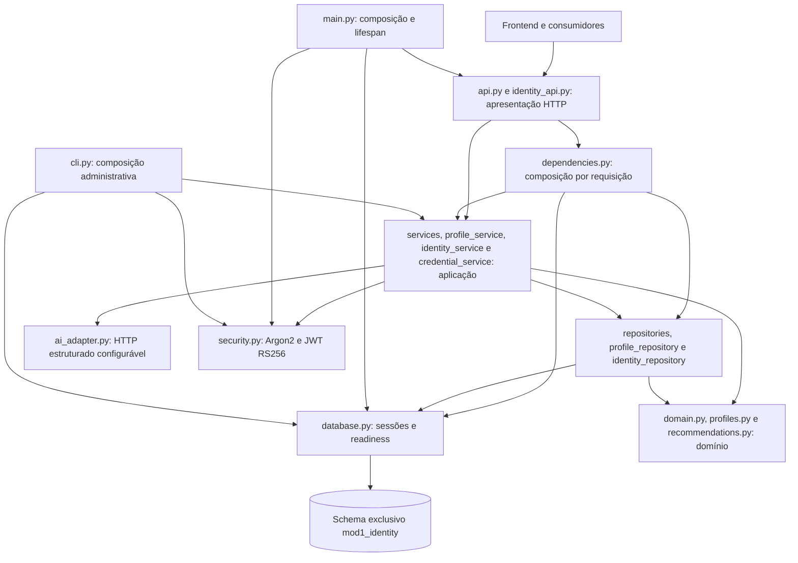
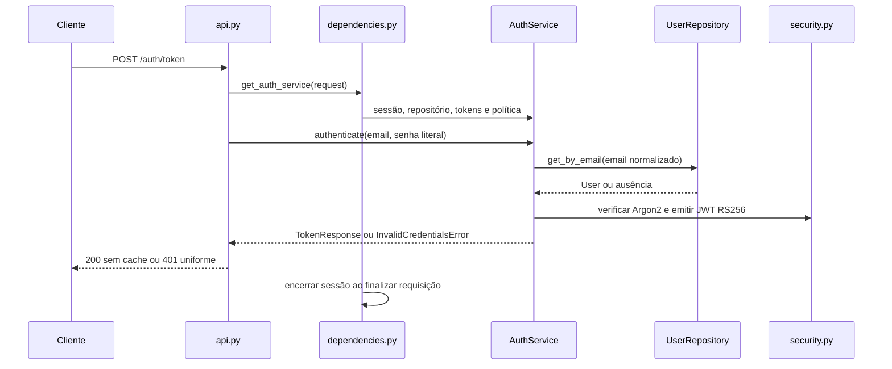

# Arquitetura da Identidade

O sistema integrado usa microsserviços; este repositório implementa a Identidade
com arquitetura multicamadas pragmática. Os módulos permanecem na estrutura
atual, com responsabilidades e dependências verificadas por testes.

## Responsabilidades e fronteiras

O transporte transacional real escolhido é o Resend. `resend_adapter.py` pertence
à infraestrutura, chamado por `mail_adapter.py`, sem banco ou dependências de
rotas. Configuração e contrato estão em [resend.md](resend.md); nenhuma chave
vai para o frontend.

| Camada | Módulos | Responsabilidade |
| --- | --- | --- |
| Apresentação | `api.py`, `identity_api.py` | Contratos HTTP, validação de entrada, serialização e tradução de erros de negócio para status HTTP. |
| Aplicação | `services.py`, `profile_service.py`, `identity_service.py`, `credential_service.py`, `recommendation_service.py` | Cadastro, sessões, revogação, auditoria/administração, recuperação/MFA, perfil/diretório consentido e propostas de análise com decisão humana. |
| Domínio | `domain.py`, `profiles.py`, `recommendations.py` | Usuário, erros, perfil, sugestões tipadas e validações puras. |
| Infraestrutura | `repositories.py`, `profile_repository.py`, `identity_repository.py`, `database.py`, `security.py`, `credential_crypto.py`, `mail_adapter.py`, `ai_adapter.py`, `config.py` | Persistência/transações, ORM, configuração, JWT/JWKS, TOTP, criptografia de seeds, entrega de e-mail e HTTP estruturado. |
| Composição | `main.py`, `dependencies.py`, `cli.py` | Montagem de recursos e serviços, ciclo de vida, CORS, tratamento genérico de falhas e administração explícita. |

Aplicação pode depender dos repositórios concretos e da segurança, sem importar
FastAPI, SQLAlchemy ou modelos ORM. Os repositórios retornam `User`/`Profile`,
sem expor registros ORM aos casos de uso. Domínio não importa HTTP, banco,
configuração nem serviços. `security.py` também permanece independente de FastAPI.

As rotas recebem serviços por `Depends`; não abrem sessões nem constroem
repositórios. `dependencies.py` abre e encerra a sessão de cada requisição e
injeta as mesmas configurações de senha e token usadas anteriormente. Os nomes
`get_auth_service`, `get_user_service` e `get_profile_service` continuam
disponíveis em `api.py` por importação, inclusive para overrides de dependências.
As transações continuam pertencendo aos repositórios.

## Fluxos

`GET/PATCH /auth/profile` resolve a conta atual pelo Bearer em `AuthService`
antes de consultar/alterar seu perfil via `ProfileService` e `ProfileRepository`.
A troca de senha mantém a comparação atômica do hash anterior no repositório.
Assinatura RS256, issuer/audience, JWKS público, erros uniformes e proteção contra
exposição de senhas seguem os contratos de integração existentes.

`/health/live` informa a disponibilidade do processo. `/health/ready` recebe um
booleano de `get_database_readiness`; a consulta fica em
`database.database_is_ready`, que verifica usuários e o schema de segurança, e traduz falhas
SQLAlchemy em indisponibilidade. A API não cria tabelas nem chaves no startup:
`init` continua sendo uma operação administrativa explícita e idempotente.

## Verificação e limites

`tests/test_architecture.py` inspeciona a árvore sintática dos imports e acessos
de persistência, distinguindo rotas de composição. Reintroduzir SQLAlchemy no
domínio/aplicação, repositórios nas rotas ou abrir sessões nas rotas falha nesses
testes. A suíte funcional verifica HTTP, autenticação, perfil, indisponibilidade,
persistência, CLI e transações; confira [as evidências](verification.md).

Cada instância acessa somente seu schema de Identidade. Projetos e Backlog
consomem JWT/JWKS e gerenciam seus próprios dados; não há consultas às tabelas
desses serviços. SQLite temporário testa comportamento local; testes PostgreSQL
exigem uma instância local descartável e não podem usar Neon. Esta refatoração
mantém os contratos existentes e adiciona sessões, MFA e administração. `init`/`migrate`
adicionam tabelas de segurança, preservando os registros anteriores. Startup não
executa migrações nem deploy. Os novos contratos e a mudança intencional de revogação
após troca/reset de senha estão em [Segurança da Identidade](identity-security.md).
